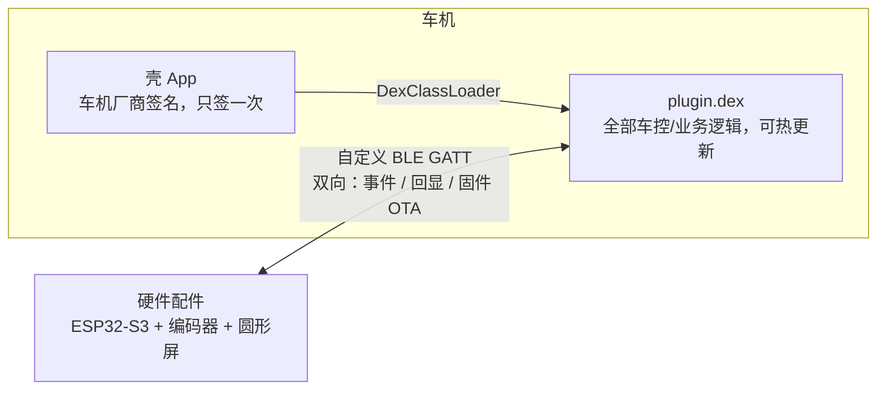

# Knob — 车机蓝牙旋钮配件

> 目标车机的「蓝牙物理旋钮配件」DIY 项目。
>
> **硬件端**：ESP32-S3 + 圆形屏 + 旋转编码器，通过自定义 BLE GATT 服务上报单击/双击/长按事件（转动只在旋钮本地生效），同时接收车况显示数据，并支持经蓝牙升级固件（OTA）。
> **车机端**：Android App（壳 + DEX 热加载插件），解析旋钮事件并翻译成车控动作（空调 / 座椅通风加热），同时把车况回显给旋钮屏幕。

## 核心思路



- **硬件 = 旋钮**，不知道也不关心自己在控制什么，只管上报事件、显示手机推来的数据。
- **App = 大脑**，负责事件→动作映射，执行车控，并把结果回显给旋钮屏幕。
- **壳只签名一次**，只负责加载插件、日志和权限申请；BLE 连接、车控、界面全在插件里，后续所有代码更新通过下发插件完成，避免反复"上传→签名→装车"。
- **插件包顺带升级旋钮**：插件和旋钮固件打成一个 zip 分发，插件连上旋钮发现固件版本不一样就自动 OTA，旋钮装在车上不用再拆下来插电脑。

（最初计划走标准 BLE HID 键盘 + 无障碍服务捕获按键，实测目标车机没有暴露无障碍服务开关入口、这条路走不通，现已替换为上面这套自定义 GATT 方案，详见 `docs/项目历程与架构.md`。）

## 目录结构

```
├── app/                 # 壳 App（Android 工程，cn.icarus.knob）
│   ├── 使用与验证指南.md  # App 用法 / 实车验证步骤说明书
│   └── app/src/
│       ├── byd/ · generic/  # 按平台分的 flavor：权限声明 + PlatformConfig
│       └── main/java/cn/icarus/knob/
│           ├── api/          # 壳↔DEX 契约：KnobPlugin / KnobHost / Ui
│           ├── plugin/       # PluginLoader：导入并加载 plugin.dex
│           ├── host/         # KnobHostImpl：壳向插件提供的能力（只剩日志）
│           ├── util/         # 日志（LogSink）/ CrashHandler
│           └── KnobActivity / KnobApp / BootReceiver / RuntimePerm
├── plugin/               # 插件工程（编译产出 output/plugin.dex，可反复更新）
│   └── src/main/
│       ├── flags-real/ · flags-simulate/  # BuildFlags.kt：真实车控 / 模拟两个变体
│       └── kotlin/cn/icarus/knob/
│           ├── api/               # 与壳完全相同的契约副本（改动须两边同步）
│           └── plugin/
│               ├── MainPlugin.kt      # KnobPlugin 接口实现（入口 + 交互状态机）
│               ├── BleManager.kt      # 自定义 BLE GATT：扫描配对、重连、按键/显示编解码、固件 OTA
│               ├── FirmwareBundle.kt  # 从插件包里读出并校验旋钮固件
│               ├── CarControl.kt      # 车控引擎（BYDAUTO 调用）
│               └── PluginSelfTest.kt  # 一键全量自检
├── firmware/             # 旋钮固件（PlatformIO，ESP32-S3+GC9A01+EC11，含自定义 BLE GATT 通信和 OTA）
│   └── simulate/         # 电脑上用真 LVGL 渲染屏幕截图/动画（CMake），改界面不用烧板子
├── hardware/             # 旋钮 PCB（KiCad）：V1 / V2
├── store/                # 应用商店素材（图标 + 预览图）
└── docs/                 # 全部分析知识 / 方案
    ├── INDEX.md          # ← 文档索引（先读这个）
    ├── 项目历程与架构.md   # 完整发展历程 + 当前架构/协议/交互设计
    ├── 验证结论.md        # 实车验证事实清单（持续更新）
    ├── 设计/旋钮圆屏UI/    # 圆屏界面设计稿（PNG/HTML + 规格），由 gen.mjs 生成
    └── ROADMAP.md        # 路线图与当前状态
```

## 快速开始

```bash
# 壳 App（比亚迪车机）→ app/app/build/outputs/apk/bydRelease/app-byd-release-unsigned.apk
cd app && ./gradlew assembleBydRelease

# 插件包（插件 + 旋钮固件）→ plugin/output/knob-plugin-<板子>-<固件版本>.zip
# 板子：Pcb（V1）/ PcbV2 / Devkit；需要 PlatformIO（pio）
cd plugin && ./gradlew pluginPackagePcb

# 只要插件、不带固件 → plugin/output/plugin.dex（SDK 版本见根目录 gradle/libs.versions.toml，SDK 路径自动探测）
cd plugin && ./gradlew pluginDex
```

装车流程：U 盘安装壳 APK（需车机厂商签名版）→ 打开壳点「📥 选择插件」，用文件选择器选中插件包 zip 或 `plugin.dex`（自动拷进 App 私有目录，之后每次启动自动加载）→ 右半边出现插件页面即成功。导入的是插件包时，插件连上旋钮会自动给旋钮升级固件。更多构建变体（`generic` 壳、模拟版插件）见 `AGENTS.md` §4，装车细节见 `app/使用与验证指南.md`。

## 关键事实（已验证）

- 无 root、无 adb，只能 U 盘装 APK。
- `BYDAUTO_AC_GET/SET`、`BYDAUTO_SETTING_GET/SET` 是 **signature 级权限**（protectionLevel=2），普通签名 App 车机不授予 → 直接 HAL 车控被挡死（实测，见 `docs/验证结论.md`）。
- 能直接控车的应用都持有车机厂商签发的签名，且不存在额外的包名白名单——拿到签名即获得对应权限。本项目已通过官方开发者认证流程申请到车机厂商签名，只用官方 SDK 声明的接口（未声明的方法通过反射调用，见 `docs/项目历程与架构.md`）。
- 无障碍服务方案已弃用：最初计划用无障碍服务捕获蓝牙 HID 按键，实测目标车机没有暴露无障碍服务开关入口，无法启用，已替换为自定义 BLE GATT 双向通道，无障碍服务在本项目中不再使用。

## 文档导航

所有知识文档的索引见 [`docs/INDEX.md`](docs/INDEX.md)；工具/代理请先读 [`AGENTS.md`](AGENTS.md)。
