# 旋钮圆屏 UI 重设计

> 状态：**固件已按本设计实现（含字体），V1 板真机跑过一轮**，按反馈改了座椅页（分页标记一排、座位名放大）、分控副驾方向（镜像半环 + 副驾反向拧）、数字等宽；改后的版本待真机复测。见文末「固件实现」。

ESP32-S3 旋钮上 240×240 圆屏（GC9A01）的新视觉方案：深色仪表刻度盘风格，覆盖固件 `ScreenState` 的全部状态和三种数据布局（`ac_link` / `ac_split_*` / `seat`）。所有尺寸、坐标、字号都按**设备像素**给出（图里放大 2 倍显示，外圈金属表圈只是示意），可以直接对照着写 LVGL。

- 浏览器打开 [index.html](index.html) 一页看完全部画面和规格（需联网加载 Google Fonts）
- 单张图在 [png/](png/)
- 改设计改 [gen.mjs](gen.mjs) 再重跑，不要手改生成物：`node gen.mjs`（只用 Node 自带模块；截图依赖本机 chromium，`--no-png` 只出 index.html）

## 画面

### 数据画面

| | | |
|---|---|---|
| 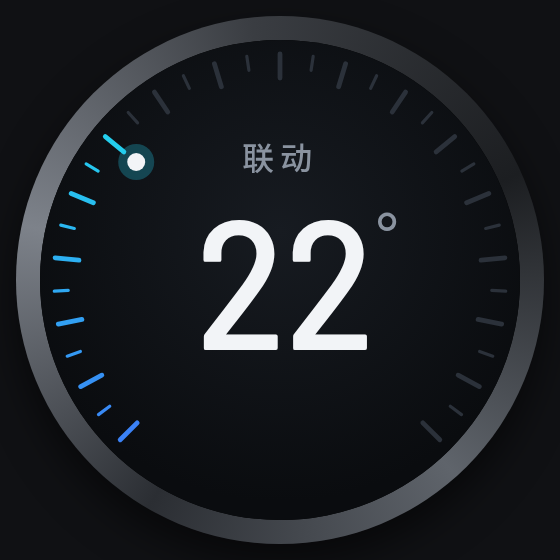 联动 · 静止 | 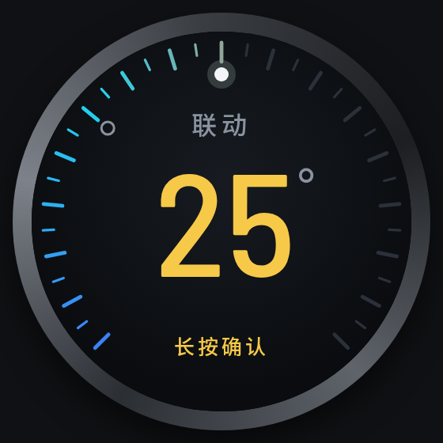 联动 · 转动中（未提交） | 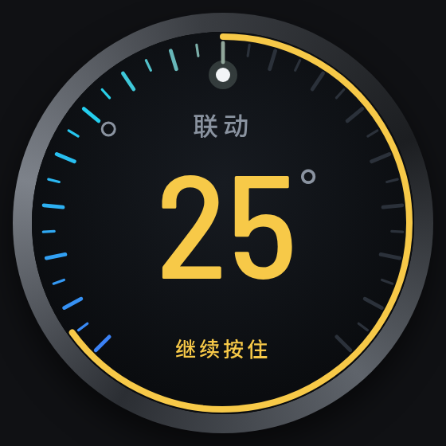 联动 · 长按提交中 |
| 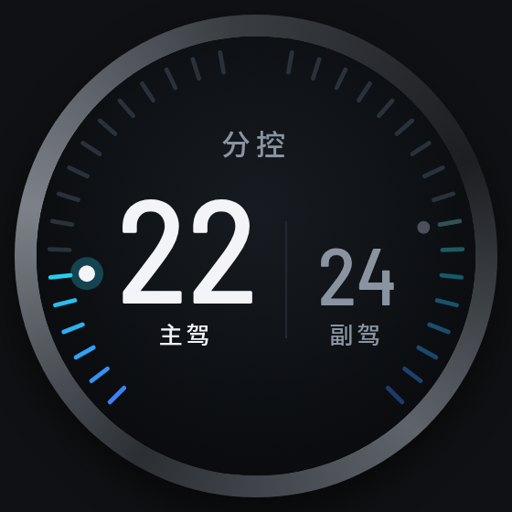 分控 · 编辑主驾 | 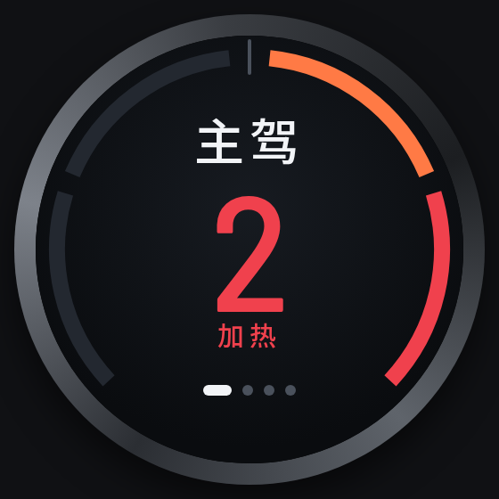 座椅 · 主驾加热 2 档 | 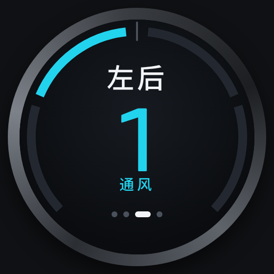 座椅 · 左后通风 1 档 |

### 连接与系统状态

| | | |
|---|---|---|
| 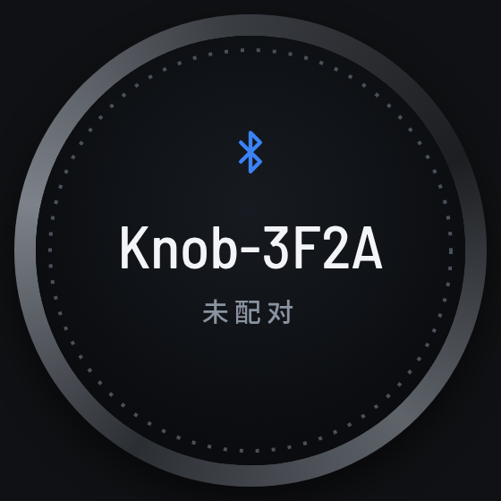 未配对（广播中） | 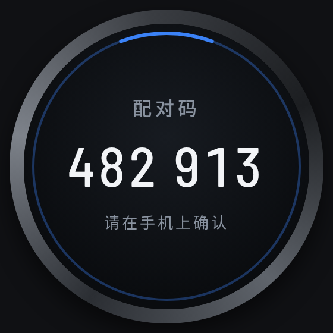 配对码 | 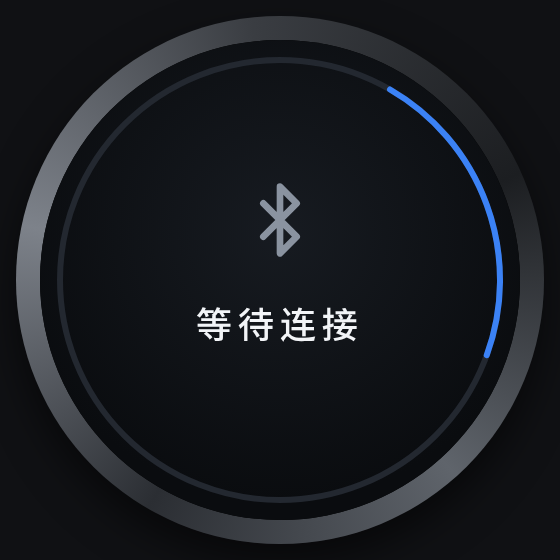 等待连接（已配对、断开中） |
| 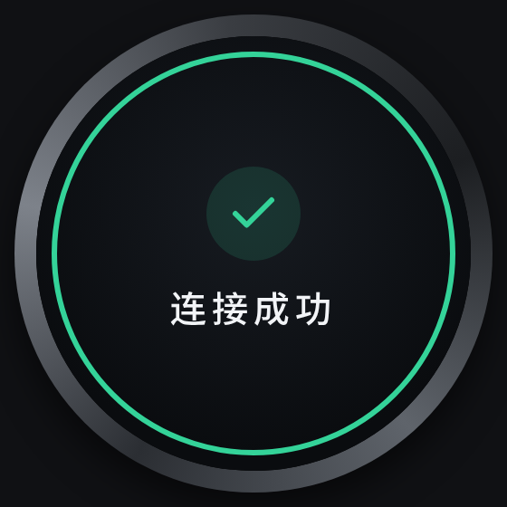 连接成功（1 秒提示） | 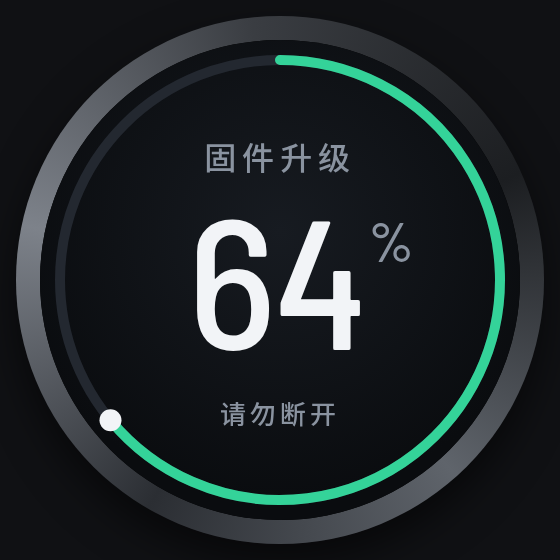 固件升级 | |

### 现状（对比用）

按 `main.cpp` 里的数值重建，LVGL 默认圆弧的宽度和底色是估的，跟真机可能有出入。

| | |
|---|---|
| 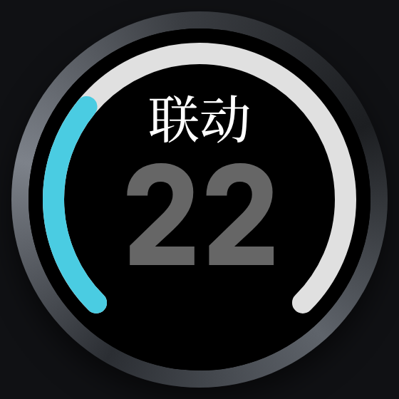 现状 · 联动 | 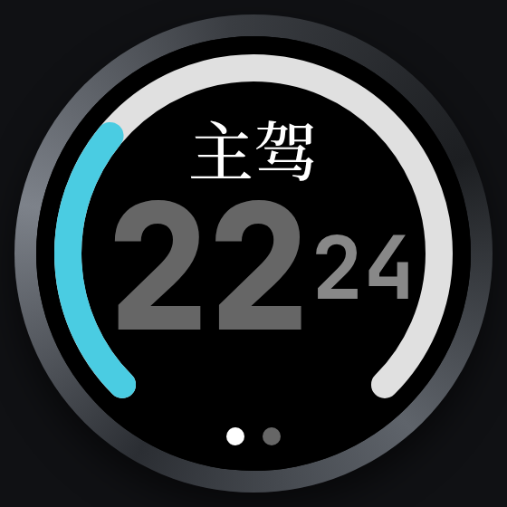 现状 · 分控 |

### 规格

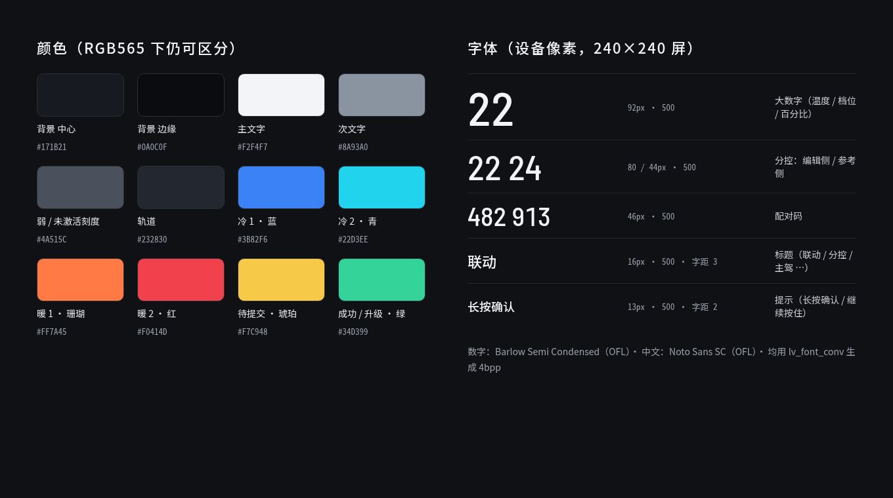

## 相对现状改了什么

| 现状的问题 | 新设计 |
|------|------|
| 静止时大数字是灰色 `#666666`，看着像没在工作 | 静止时数字是白色 `#F2F4F7` |
| 粗圆弧是 LVGL 默认样式，跟黑底配在一起显得生硬 | 改成刻度环：每 0.5° 一根，整数位更长；走过的刻度按冷暖渐变着色，当前值处一个亮点 |
| 转没转过只靠灰/白区分，不明显 | 转动后未提交：数字变琥珀色、环上留空心点标原值、底部出「长按确认」；长按进度环也是琥珀色。**琥珀色只表示「还没提交」** |
| 中文用衬线体 NotoSerifSC，跟等宽数字不搭 | 中文换 Noto Sans SC，数字换半窄体 Barlow Semi Condensed |
| 分控两个数字太挤（代码里一直在调 `DUAL_GAP`） | 环拆成左右两半：左主驾、右副驾，左右镜像、两边都是温度越高越靠上；右半环升温是逆时针，所以**编辑副驾时旋钮反过来拧（逆时针升温）**，亮点始终跟着手转的方向走。编辑侧大字亮、参考侧小字暗。半窄体让两个数字放得下。（最早副驾半环越热越靠上、旋钮却是顺时针升温，真机上手往一边转、亮点往另一边走很别扭；中间试过两个半环都顺时针、副驾热端在下，最后定为镜像 + 副驾反向拧） |
| 座椅显示 `-2` 这样的数字，要靠颜色猜是通风还是加热 | 4 段弧：左边通风（蓝/青），右边加热（珊瑚/红），正上方是「关」；中间显示档位 + 「加热」/「通风」 |
| 底部一排点看不出选中的是哪个座位 | 顶部座位名放大到 28px、改白色，认座位全靠它；底部保留一排分页标记（当前那个拉长成胶囊），只表示一共几个、轮到第几个。（曾试过 2×2 座位图，真机上嫌两行占地方、座位名 16px 灰字太小，已改回一排） |

## 关键数值（设备像素）

圆心 (120, 120)，角度 0° 指右、顺时针为正（跟 SVG 一致；LVGL 的 `rotation` 也是这个方向）。

| 元素 | 数值 |
|------|------|
| 温度刻度环 | 135° 起扫 270°（缺口朝下）；17~33℃ 每 0.5° 一根；整数刻度 r 101→113、线宽 2.4，半度刻度 r 106→113、线宽 1.6；未走过的刻度 `#2B313A` |
| 当前值亮点 | r 93 处，实心白点半径 4.5 + 同色光晕半径 9（不透明度 28%） |
| 原值空心点 | r 93 处，半径 4、描边 1.5 `#8A93A0`，只在未提交时显示 |
| 长按提交进度环 | r 117、线宽 4、`#F7C948`，从正上方顺时针 |
| 分控半环 | 左半 135°→260°、右半 45°→−80°（低温→高温，都是从下往上），每 1℃ 一根，r 102→113；参考侧已走过的刻度不透明度 40%；编辑副驾时旋钮逆时针升温 |
| 座椅 4 段弧 | r 108、线宽 9、平头；−2: 137°~197°，−1: 203°~264°，+1: 276°~337°，+2: 343°~403°；正上方 r 99→117 一根「关」刻线 |
| 座椅座位名 | Noto Sans SC Medium 28px、`#F2F4F7`、字距 3，竖直中心 y 58（跟其它页标题同一行，其它页是 16px `#8A93A0`） |
| 座椅分页标记 | 一排，中心 y 199，高 6、间距 6；当前 16×6 白色胶囊，其它 6×6 圆点 `#4A515C`；顺序主驾→副驾→左后→右后 |
| 固件升级环 | r 110、线宽 5，轨道 `#232830`，进度 `#34D399`，头部白点半径 5.5 |
| 背景 | 径向渐变，中心偏上 `#171B21` → 边缘 `#0A0C0F`；开销太大就用纯色 `#0A0C0F` |

颜色和字号见上面的规格图，或 `gen.mjs` 开头的 tokens。冷暖渐变四段色标：`#3B82F6` → `#22D3EE` → `#FF7A45` → `#F0414D`（替换现在 `gradient_color()` 里的 Material 色）。

## 固件实现

已在 `firmware/src/main.cpp` 按本设计实现（`build_ui()` / `dial_draw_cb()` / `redraw_*()`），V1 板（`pcb`）真机跑过一轮，按反馈修改后待复测。

- **环、刻度、图标**：没用 `lv_scale`/`lv_arc`，所有环、刻度、亮点、座椅分页标记、蓝牙/对勾线条图标都在一个全屏透明对象的绘制回调 `dial_draw_cb()` 里按状态用 `lv_draw_line`/`lv_draw_arc`/`lv_draw_rect` 现画；等待连接/等待数据的转圈也在这里画（`draw_spinner()`），不用 `lv_spinner`：照 Material 3 Expressive 的算法，6 秒一个周期、首尾无缝（`s_spinner_style` 还留着 Material 经典款可切换）。长按提交/清配对进度环是独立的叠加层（`s_overlay_percent`），`redraw()` 不碰它。
- **未提交状态**：沿用 `s_value != s_synced_value` 判断，表现为琥珀色数字 + 空心原值点 + 「长按确认」；按住出进度环后提示换成「继续按住」。
- **字体**（`firmware/src/fonts/`，`lv_font_conv` 1.5.3，4bpp，不压缩，不勾 `--lcd`，生成参数见各文件开头的 Opts；许可证 `OFL-*.txt` 同目录）：
  - 数字 Barlow Semi Condensed Medium：`font_num_92`（大数字）、`font_num_80`（分控编辑侧）、`font_num_44`（分控参考侧、配对码）、`font_num_34`（设备名，符号集 `Knob-0123456789ABCDEF`）、`font_num_28`（只有 `%°`）。
  - `font_num_92` / `font_num_80` / `font_num_44` 用的是**等宽数字**（tnum）：Barlow 默认是比例数字，「1」比「0」窄 16px（80 号），分控拧动时数字宽度一变、两列整体居中就跟着左右跳。`lv_font_conv` 不套用 OpenType 特性，所以先用同目录的 `freeze_tnum.mjs` 把 tnum 字形固化进 cmap（`node freeze_tnum.mjs BarlowSemiCondensed-Medium.ttf BarlowSemiCondensed-Medium-tnum.ttf`，只用 Node 自带模块；生成字体本来就要 Node 跑 `lv_font_conv`），生成 `BarlowSemiCondensed-Medium-tnum.ttf`，再用它生成这三份（文件开头 Opts 里的字体名就是它）。
  - 中文 Noto Sans SC Medium：`font_zh_13` / `font_zh_16` / `font_zh_20` 共用一份字表（字表外字符回退到 `lv_font_montserrat_18`），`font_zh_28` 只有座位名「主驾副左后右」（字表外回退到 `font_zh_20`），`font_zh_44` 只有「关」。
  - 原始字体文件不入库，要重新生成时先下载：Barlow 用 Google Fonts 仓库的 `ofl/barlowsemicondensed/BarlowSemiCondensed-Medium.ttf`（github.com/google/fonts），Noto Sans SC 用 `Sans/SubsetOTF/SC/NotoSansSC-Medium.otf`（github.com/notofonts/noto-cjk）。命令照各文件开头的 Opts 用 `npx -y lv_font_conv@1.5.3 …` 跑；数字三份先过一遍 `freeze_tnum.mjs`。
  - ⚠️ 新增上屏中文要把字补进三份 `font_zh_*` 的 `--symbols` 重新生成，缺的字直接显示不出来。生成后把文件开头的 include 段换成带 `__has_include` 的写法（1.5.3 默认只认 `lvgl/lvgl.h`，PlatformIO 和 `firmware/simulate` 都找不到）。
- **分控副驾反向拧**：分控编辑副驾（`ac_split_deputy`）时，`loop()` 里把旋钮的转动量取反，逆时针升温，跟镜像的右半环方向一致。只在固件本地做，插件不知道这回事。
- **跟设计稿的小差别**：中文正文字号合并成 13/16/20 三档（设计稿里的 15px → 16、18px → 20；座椅座位名单独一份 28，跟设计稿一致）；「请在手机上确认」用的 Medium 字重（设计稿是 400）。
- **对照验证**：`cd firmware/simulate && cmake -B build && cmake --build build -j` 会用真正的 `main.cpp` + LVGL 在电脑上渲染全部状态（`firmware/simulate/out/`），改完固件先跟本设计稿对照，不用每次烧板子；`--target anim` 出动画。用法见 `firmware/simulate/CMakeLists.txt` 开头。
- 插件推送的数据格式没改：座椅的「加热/通风」由 `value` 正负决定，分页标记由 `sub_count`/`sub_index` 决定；分控画面的标题由固件写死「分控」（不用插件发的 `title`），主驾/副驾标签画在数字下方。
