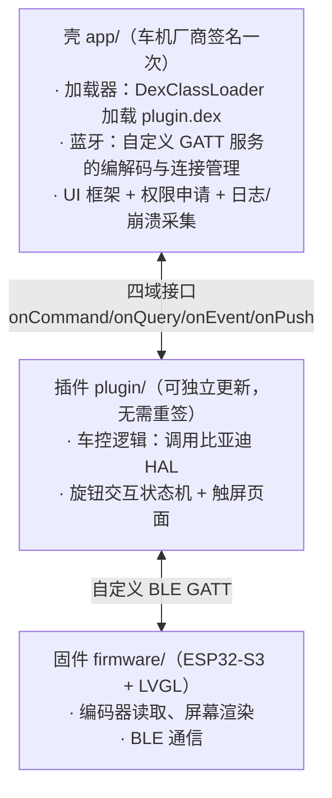

# 项目历程与架构

> 本文档汇总项目从立项调研到当前状态的发展脉络，以及现在的实际架构/协议/交互设计。跟其它文档的关系：`项目策略备忘录.md`/`ROADMAP.md` 记录的是某个时间点的决策/进度状态，本文档是把整条时间线串起来讲清楚"为什么走到今天这个架构"；具体的接口设计细节仍以 `壳-DEX热加载架构设计.md`、`验证结论.md` 为准，本文档不重复展开，只在需要说明"为什么变了"的地方引用。
>
> 涉及分析第三方应用的部分，只写分析得到的技术结论，不点名具体产品。

## 一、项目是什么

给比亚迪车做的物理蓝牙旋钮配件：ESP32-S3 + GC9A01 圆形屏 + EC11 旋转编码器，配合一个跑在车机上的 Android 伴侣 App，控制空调（温度、主驾/副驾独立温控）和座椅通风/加热。硬件负责上报"转/点/长按"，App 负责解释这些事件并通过比亚迪官方车控 HAL 真正执行。

## 二、发展历程

### 阶段 0：立项前的可行性规划

最初的方案是一个蓝牙配件（旋转编码器+按键）伪装成标准 BLE HID 键盘，车机端 App 用无障碍服务捕获按键事件、翻译成动作。车控（空调/座椅）从一开始就被明确标注为整个计划里最不确定的部分——大多数车的车控走厂商私有协议，第三方很难碰，因此规划上把"系统级功能"（音量、媒体）当作一期必达目标，车控当作探索性二期目标。

配套规划了"投入硬件之前先证明车控到底能不能做"的调研路子：反编译车机自带的空调控制模块，或者反编译一个已知能控车的第三方 App，判断它是走"无障碍模拟点击"还是"直接调车辆控制接口"。车机自带空调模块因为设备拿不到 adb、无法提取，最终没有走这条路，直接调研了现成的第三方应用。

### 阶段 1：分析第三方应用，确认直接控车可行

分析了一款同类的蓝牙旋钮/按键配件配套应用，确认它是**直接调用比亚迪系统 HAL**（`android.hardware.bydauto.*`）控制空调/座椅，不是模拟点击；它的无障碍服务只用来捕获自己那套蓝牙硬件上报的物理按键事件，从未用来操作车机 UI 执行车控。它同样持有比亚迪（车机厂商）签发的签名，才拿到了 `BYDAUTO_*` 这类 signature 级权限——不存在额外的包名白名单机制，权限门槛就是签名本身。这是这个阶段最重要的发现：证明了直接调 HAL 控车在这台车机上真实可行，不只是理论上的可能，路径也很明确——拿到同样级别的签名即可。

这次分析也带来了具体的技术信息，贯穿了项目后续实现：HAL 设备/方法清单、常量取值（温度范围、座椅通风/加热档位、座椅编号、命令返回码），以及一个关键结论——**部分 HAL 方法（座椅通风/加热的设置接口）在真机上存在，但官方发布的编译期 SDK 里没有声明**，需要通过反射调用才能使用。这个结论在项目后期（阶段 7）独立用真机反射验证过一次，结果完全吻合。

其中座椅通风/加热的参数约定也是这次确认的：座位编号 1~4 分别对应主驾/副驾/后排左/后排右；档位用同一个带符号的数值表达——负数对应通风档位（数值越小档位越高），正数对应加热档位，0 无效。这个符号方向后来发现跟本项目自己独立设计的座椅档位状态字段（用负数表通风、正数表加热）不谋而合，属于设计被反向验证对了，不是巧合抄来的。

### 阶段 2：真机权限实测

用一个最小的 Android 测试应用直接在真车上测权限行为，确认：

- `BYDAUTO_AC_COMMON`/`BYDAUTO_SETTING_COMMON` 是 dangerous 级权限，运行时可申请。
- `BYDAUTO_AC_GET/SET`、`BYDAUTO_SETTING_GET/SET` 是 signature 级权限，普通签名的应用申请不到，实际车控写操作会被系统拒绝。
- 结论：拿到车机厂商签名是唯一出路，"无障碍模拟点击"作为兜底路线在这一步被明确放弃，全押官方签名路线。

（这次实测中曾读到一次返回值 `-2147482645`，当时归因为权限问题——跟后面阶段 7 提到的另一次同样数值的读数是两个独立的 bug，只是巧合用了同一个错误码，详见阶段 7。）

### 阶段 3：官方开发者认证拿签名

通过比亚迪官方开发者平台完成认证、申请车控能力，拿到了车机厂商签发的签名。之后用这个签名对应用重新签名，车控相关的 signature 级权限才被真正授予。

### 阶段 4：壳 + DEX 热加载架构

为了避免每次改代码都要重新走一遍签名流程，把应用拆成两部分：

- **壳**：只签名一次，负责加载插件、管理蓝牙连接、承载 UI 框架。
- **插件**：以可独立分发、可热更新的 DEX 文件形式加载（`DexClassLoader` 运行时加载，继承壳进程的 UID，也就继承了签名授予的权限），承载全部车控/业务逻辑。

接口契约收窄成四个固定域——`onCommand`（控制）、`onQuery`（查询）、`onEvent`（外部事件）、`onPush`（壳主动推送）——新增功能只在这几个域里加路由分支，壳的接口本身永远不变，也就永远不需要因为业务功能变化而重新签名。

### 阶段 5：旋钮硬件打底

选定 ESP32-S3 + 圆形 GC9A01 SPI 屏 + EC11 机械旋转编码器，跑 LVGL。屏幕驱动和 LVGL 集成部分是在一个开源智能旋钮硬件项目（**X-Knob**，MIT 协议）的基础上改的——原项目是围绕无刷电机+磁编码器做的旋钮，本项目保留了屏幕和 LVGL 这部分脚手架，把电机/磁编码器输入层换成了普通 EC11 的 A/B 相读取，去掉了原项目的联网功能。

这个阶段只验证了纯本地行为（屏幕渲染、编码器转动/点击检测、本地模拟数值），还没有接蓝牙、没有接车。

### 阶段 6：蓝牙链路——计划与实际不同

最初计划是 BLE HID 键盘 + 壳的无障碍服务捕获按键事件（跟阶段 1 分析的第三方应用思路一致）。这条路真的实现过，但遇到了这台车机特有的硬性障碍：**车机定制的 Android 系统没有暴露标准的无障碍服务开关入口**，无法启用无障碍服务，导致这条输入路径完全走不通（这是车机系统定制导致的问题，不是方案本身的缺陷）。

最终替换为完全自定义的双向 BLE GATT 服务：一个特征值（NOTIFY）上报旋钮侧按键事件（单击、长按，长按会带上本地编辑到的最终值），另一个特征值（WRITE）让手机把显示数据写回旋钮屏幕。壳在这条通道里只是纯粹的字节编解码器，不理解任何字段含义——字段的意义只由插件（业务逻辑）和固件（渲染）两端约定。

### 阶段 7：在真实 HAL 上搭建车控功能

签名和壳/插件架构就绪后，开始在官方 HAL 上实现具体功能：

- 空调温度（联动 + 独立温控）、座椅通风、座椅加热——官方 SDK 声明了的直接调用，没声明的通过反射调用（跟阶段 1 的发现一致，这次会话独立用反射把真机设备类整个扫了一遍，结果与阶段 1 的分析完全吻合）。
- 设备使用前需要先"启用"（通过设备管理器的 `enableDevice`），这一步需要用反射调用，因为其声明的父类在官方编译期 SDK 里无法解析（曾尝试直接引用，确认会导致编译失败）。这一步是否严格必需目前尚未完全确认——官方文档没有明确要求，但阶段 1 分析的应用在使用任何设备前都会调用它，而且它的设备查找逻辑还反射进了设备管理器实例内部一张私有的设备表，用来登记/查找已启用的设备，说明这一步大概率不是可有可无的模板代码，而是真的在往内部状态里注册设备。
- 加入了空调温度的实时变化监听（语音、物理按键改变温度时能同步回来），真机验证有效。**独立温控（分控）状态没有对应的监听接口**——查证过官方 SDK 声明的监听方法列表，确认完全没有覆盖这个字段，因此任何依赖这个状态的逻辑都不能信任缓存值，只能在需要时主动断言。
- 独立定位到第二次、原因完全不同的 `-2147482645` 读数：一次读取调用传入了一个只对写入调用合法的参数值，HAL 正确返回了官方定义的"参数无效"错误码，巧合与阶段 2 那次是同一个数值。修复方式是不再发起这次不合法的调用。
- 固件侧加入了环境光驱动的背光亮度调节、PWM 背光控制。

### 阶段 8：旋钮交互模型重构

最近对物理旋钮的转动/单击/长按手势如何映射到空调温度、座椅控制，以及手机与旋钮之间显示同步协议的形状，做了一次系统性重新设计，详见下文"四、旋钮交互设计"。

### 阶段 9：固件版本号 + 插件包内置固件、连上自动 OTA

目标是旋钮装在车上不用再拆下来插电脑：车机上导入新插件，插件连上旋钮发现固件版本跟自己带的不一样，就自动把固件推过去。

- **版本号**：`firmware/VERSION` 写人工维护的语义版本，编译时 `firmware/scripts/version.py` 拼上 git 信息，生成 `0.1.0+c8cd265` 这样的版本号（`+` 后面是最近一次改动 `firmware/` 的提交）。工作区有没提交的改动时再加 `.dirty.<指纹>`，指纹是改动内容的 SHA-1 前 7 位——改一行代码版本号就变，同样的代码编两次版本号不变。旋钮通过标准设备信息服务（0x180A）的固件版本（0x2A26）、硬件版本（0x2A27，填板子名 `pcb`/`devkit`）两个特征值上报。
- **插件包**：`pluginPackage<板子>`（如 `pluginPackagePcb`、`pluginPackagePcbV2`）把 `classes.dex` 和 `firmware/firmware.bin`、`firmware/manifest.json`（版本、板子、大小、SHA-256）打成一个 zip。壳不用改：它把选中的文件原样存成 `plugin.dex`，ART 按文件头认出是 zip，照样加载里面的 `classes.dex`；插件再按路径用 `ZipFile` 打开同一个文件读固件（文件名是 `.dex`，类加载器不会把它当 zip 查资源）。固件 bin 在包里是独立文件，不嵌进代码。
- **OTA**：固件新增一个 OTA 特征值，协议见"四、蓝牙协议"。数据写进当前没在用的 app 分区（`default_8MB.csv` 两个 app 分区各 3264K，不用改分区表），收齐后校验 SHA-256 再由 `Update.end()` 校验镜像，都通过才切换启动分区；中途断线、出错都放弃，旧固件不受影响。暂不做回滚（新固件能启动但有 bug 时，只能再导入一个带旧固件的插件包降级）。
- **自动升级条件**：插件包带：插件包带了固件、旋钮上报的板子跟包里一致、版本号不同、旋钮支持了固件、旋钮上报的板子跟包里一致、版本号不同、旋钮支持 OTA，四条都满足就开始，不弹确认；升降级都算"不同"。防死循环：同一个目标版本最多自动试 2 次（新固件上报的版本要是跟包里写的对不上，每次连上都会再升一遍），旋钮版本对上了或者重新导入插件包才清零。
- 踩过的坑：
  - 手机缓存了旧固件的 GATT 服务列表，换了固件也看不到新特征值——插件发现缺了需要的特征值，就反射调 `BluetoothGatt.refresh()` 清缓存再发现一次（每次连接最多一次）。
  - 小米手机（Android 16）会回调两次 `onMtuChanged`，要去重，否则整个服务发现流程走两遍、写操作互相撞车。
  - 固件在处理 BEGIN 的回调里就发 READY 通知，通知比 BEGIN 的写回执先到手机。插件起初按阶段推断"这个写回执是谁的"，把迟到的 BEGIN 回执当成了第一包数据的回执，第一包还在飞就发第二包，被系统拒绝。改成每次写都记下操作码、回执按操作码认，READY 和 BEGIN 回执都到了才开始发数据。
  - NimBLE 单个特征值最长 512 字节，MTU 517 时每包还要再减 5 字节 OTA 头，最终每包 507 字节数据。

## 三、当前架构

插件有两个编译变体：真实版（`plugin.dex`，调用真实车控 HAL）和模拟版（`plugin-simulate.dex`，在普通手机上运行、不依赖车机专有框架，用于在不接触真车的情况下验证交互逻辑）。两者由编译期开关控制，一次构建同时产出。

## 四、蓝牙协议

自定义 GATT 服务，三个特征值：

- **按键事件（NOTIFY，旋钮→手机）**：`字段ID(1字节) + 类型(1字节) + 值(2字节)` 编码，只上报"单击"（切换下一个功能停靠点）和"长按"（提交当前编辑值）两种事件，旋钮转动不再逐格上报，只在本地即时生效。
- **显示同步（WRITE，手机→旋钮）**：通用的 `键名长度+键名+类型+值` 编码，壳这一层完全不解析字段含义，含义由插件和固件两端约定。

- **固件 OTA（WRITE+NOTIFY，`468889d4-9176-4aa2-9a9e-cd7dd3ab1ae0`）**：见下文"固件 OTA 协议"。
- 另外旋钮还带标准设备信息服务（0x180A），固件版本（0x2A26）、硬件版本（0x2A27，板子名）两个特征值供插件读取。

当前的显示数据用一个 `layout` 字段区分具体形状：

| layout | 携带字段 | 用途 |
|---|---|---|
| `ac_link` | 标题、数值、范围 | 空调温度（联动模式） |
| `ac_split_main` | 标题、主驾数值、副驾数值、范围 | 独立温控 - 主驾为主编辑对象 |
| `ac_split_deputy` | 标题、主驾数值、副驾数值、范围 | 独立温控 - 副驾为主编辑对象 |
| `seat` | 标题、数值、范围 | 座椅通风/加热档位 |

### 固件 OTA 协议

手机写入的每一包第 1 个字节是操作码，多字节整数一律小端：

| 操作码 | 内容 | 含义 |
|---|---|---|
| `0x01` BEGIN | size(4) + sha256(32) | 准备接收 size 字节的固件（正在收的会作废、从头来） |
| `0x02` DATA | offset(4) + 数据 | offset 必须正好等于已收字节数，不接受乱序/重传 |
| `0x03` END | — | 收齐了：校验 SHA-256 和镜像，通过才切换启动分区 |
| `0x04` ABORT | — | 放弃，当前固件不受影响 |

- 全部用带应答的写，收到上一包的写回执才发下一包。固件在写回调里把数据写进 flash，回执在回调返回后才发，天然起到流控作用。
- 旋钮用同一个特征值的通知回报：`status(1) + 已收字节数(4)`。只在 BEGIN 成功（`0x00` READY）、END 成功（`0x01` DONE）和出错时发：`0x80` 无法开始、`0x81` 顺序不对、`0x82` 写 flash 失败、`0x83` 校验失败、`0x84` 镜像无效、`0x85` 格式不对。
- 超时：插件 15 秒收不到回应判失败；旋钮开始后 20 秒收不到数据自己放弃，屏幕回到正常画面（防止插件出错又没发 ABORT 时卡在升级画面）。
- 收到 DONE 后旋钮显示"正在重启"，1.5 秒后重启进新固件；插件靠断线重连读到新版本号。

## 五、旋钮交互设计

### 设计过程

独立温控状态没有监听接口、只能靠主动查询这个限制，是这次交互重新设计的直接起因。过程中探索、否决过几个方向，记录下来供以后遇到类似问题参考：

- 最初把问题理解成"缓存的分控状态该多久刷新一次"，提出过几种轮询策略：进页面时读一次、写之前重新查一次、页面停留期间定时轮询、完全不缓存每次现读。这个思路后来被放弃——问题不在"刷新频率"，而在于不应该依赖轮询本身去追踪一个查不到变化通知的状态。
- 转折点：既然真正会改变分控状态的动作只有"提交"，那就让提交动作本身去断言想要的状态，不需要知道、也不需要相信车上此刻的实际状态是什么。这条思路最终成了现在的设计。
- 围绕"选择当前编辑联动/主驾/副驾中的哪一个"，设计过一个"浏览态/编辑态"两阶段手势模型（单击在浏览态里切换目标，需要额外一次长按进入编辑态转动才生效，再一次长按提交）。后来发现固件本身早已经是更简单的单阶段模型——转动随时生效、单击纯粹切换页面、长按一次性提交——两阶段模型其实是在解决一个并不存在的问题，最终收敛为直接复用这套已有的单阶段手势，只是把可切换的目标从 2 个扩展成 4 个循环停靠点。
- 曾考虑过给"切换目标"单独增加一个双击手势，最终没有采用：双击识别需要在每次单击之后引入一段等待确认的延迟，会拖慢"切换到下一个"这个原本应该即时响应的高频动作；机械编码器上双击的误触发/漏触发概率也明显高于软件按键；而且增加双击并不会减少需要设计的状态数量，只是多了一种手势要处理。
- 最初的方案里，"切换到某个独立温控目标"这个动作本身会直接触发分控开关（比如切到主驾就顺便把分控打开），后来修正为：**浏览/切换永远不产生副作用**，只有明确的"提交"动作才允许改变车辆的实际配置。这是最终设计里最重要的一条约束，前面"最终设计"里的每一条都是围绕它展开的。

数字的空心/实心状态是配套加入的视觉反馈：数字保持"空心"（较暗）代表跟手机上次同步的值一致，一旦被转动过、还未提交，变为"实心"（明亮），提示当前有未提交的修改。参考弧本身只反映数值在取值范围内的大致位置，不再随交互状态改变粗细或亮度，避免和空心/实心的语义重复。

### 最终设计

物理旋钮的三种手势（转动、单击、长按）映射为：

- **转动**：实时调整当前正在编辑的数值，只在固件本地生效，不产生蓝牙通信，避免转动和屏幕反馈之间出现延迟。
- **单击**：切换到下一个功能停靠点，四个停靠点循环——联动、主驾（独立温控）、副驾（独立温控）、座椅。**单纯切换不产生任何车控副作用**，这是设计上的硬性约束：浏览/切换功能不应该改变车辆的实际配置。
- **长按（或触屏对应的"确认"操作）**：唯一会真正下发车控指令的动作。提交时无条件地先设置好这个停靠点要求的独立温控开关状态（因为该状态没有监听接口、不能信任缓存），再下发对应的温度/档位数值。

双数字的独立温控页面（主驾/副驾并排显示）中，谁大谁小由当前编辑的是哪一方决定，位置固定对应真实座位（主驾左、副驾右）。由于两个数字加起来的宽度接近圆屏物理极限，位置采用逐帧动态计算而非固定布局，以兼顾"不遮挡参考弧"与"两个数字不互相贴近"。

## 六、硬件方向调研：供电与屏幕技术

项目目前依赖车辆供电，未来可能考虑改为电池供电，但这还不是已确认的需求，属于提前调研以避免当前的硬件/固件选型跟未来方向冲突。

**蓝牙功耗**：如果电池供电成为现实，蓝牙侧的省电应该通过连接参数里的 latency（连接延迟）而不是拉长 connInterval 来做——latency 能让 ESP32 在空闲时跳过连接事件省电，一旦有真实数据（比如一次按键）要发送，仍然能在一个连接间隔（15~30ms）内完成响应，不牺牲旋钮的实时手感；单纯拉长 connInterval 会让每次按键的响应延迟到接近 1 秒，体验上不可接受，已经被排除。

**屏幕技术**：评估过 e-ink、OLED、MIP（Sharp Memory LCD 一类的反射式屏幕）作为现有 GC9A01 圆形 LCD 的电池化备选，结论是暂时保留 GC9A01：

- e-ink 整屏刷新延迟在几百毫秒到几秒之间，跟"转动旋钮立即看到反馈"这个交互诉求冲突。
- 圆形 OLED 目前主要以智能手表市场的 AMOLED 形态存在（如 1.39 寸 400×400/454×454，MIPI-DSI 接口），驱动集成复杂度明显高于 GC9A01 的简单 SPI 接口，长时间显示大面积静态内容也存在烧屏风险。
- MIP（如 Sharp LS013B7DD02，1.29 寸圆形）如果电池供电成为现实，架构上是最合适的选择（阳光下可读、静态内容几乎零功耗、刷新速度足以支持实时交互、可选前光代替背光），但目前没有现成的圆形转接板可用，需要自行开发驱动和连接件，而且是单色屏，需要重新设计一套不依赖当前配色方案的界面。
- GC9A01 基本是当前这类爱好者/DIY 硬件里圆形 SPI LCD 事实上的标准方案，没有功能相当但明显更优的同类驱动芯片可换——"更换屏幕技术路线"才是唯一有意义的备选方向，而不是"换一颗别的圆形驱动芯片"。

## 七、车控 HAL 参考：设备清单

比亚迪官方车控 HAL 按设备类型划分，每种设备对应一个内部设备类型编号，覆盖范围远超本项目实际用到的空调/座椅：

| 设备类型 | 编号 | 可控制范围（示例） |
|---|---|---|
| 空调 AC | 1000 | 温度、风量、风向、内外循环、除霜、开关 |
| 车身 Bodywork | 1001 | 车窗、天窗、遮阳帘 |
| 音频 Audio | 1002 | 音量等 |
| 灯光 Light | 1004 | 车灯 |
| 能量 Energy | 1006 | 能耗 |
| 仪表 Instrument | 1007 | 仪表显示 |
| 空气质量 PM2.5 | 1008 | 净化、负离子 |
| 充电 Charging | 1009 | 充电设置 |
| 变速箱 Gearbox | 1011 | 挡位 |
| 动力 Engine | 1012 | 引擎相关 |
| 车速 Speed | 1013 | 车速读取 |
| 统计 Statistic | 1014 | 统计数据 |
| 胎压 Tyre | 1016 | 胎压 |
| 设置 Setting | 1023 | 座椅加热/通风、方向盘加热等（本项目实际使用） |
| 时间 Time | 1024 | 时间 |
| 雷达 Radar | 1025 | 雷达 |
| 全景 Panorama | 1031 | 全景影像 |
| 门锁 DoorLock | 1041 | 门锁 |

本项目目前只用到空调（AC）和设置（Setting，座椅相关）两类设备，其余留作以后扩展参考。

## 八、开放问题

- `enableDevice()` 调用是否严格必需，尚未在真车上通过对照测试确认。
- 座椅加热的设置接口已经接通，但还未接入交互提交流程的主路径，仅有独立的测试入口。
- 独立温控状态没有监听接口这一限制，意味着车辆状态偶发外部变更（语音/物理按键）与旋钮/触屏显示之间存在短暂不一致的可能，目前靠"每次提交前重新断言"来兜底，尚未有更彻底的解决方式。
